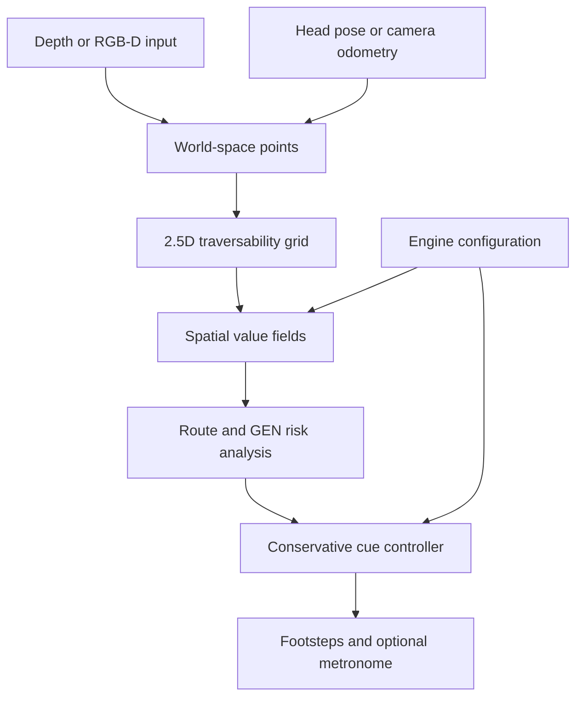

# CAFoG: Context-Aware Augmented Reality for Freezing of Gait

CAFoG is a research prototype exploring whether spatial context can be used to
select external visual and auditory walking cues for situations associated with
Freezing of Gait (FoG) in Parkinson's disease.

The current system is an engineering and research platform, not a medical device
and not evidence of clinical efficacy. It combines a Python reference pipeline
with a Unity implementation targeting Meta Quest. The repository contains
simulation, RGB-D replay, a phone-camera prototype, and Quest project code. The
Quest Android development APK has been built and passes offline structural checks,
but its behavior on a physical headset has not yet been validated.

## Contents

- [Project overview](#project-overview)
- [Research motivation and objectives](#research-motivation-and-objectives)
- [System architecture](#system-architecture)
- [How the system works](#how-the-system-works)
- [Implementation status](#implementation-status)
- [Repository structure](#repository-structure)
- [Technology and dependencies](#technology-and-dependencies)
- [Python setup and tests](#python-setup-and-tests)
- [Unity and Quest setup](#unity-and-quest-setup)
- [Hardware requirements](#hardware-requirements)
- [Safety, ethics, and clinical limitations](#safety-ethics-and-clinical-limitations)
- [Known limitations and outstanding validation](#known-limitations-and-outstanding-validation)
- [Roadmap](#roadmap)
- [Research background](#research-background)
- [Contributing](#contributing)
- [License](#license)

## Project overview

The central idea is a **label-free spatial cue engine**. Rather than identifying
objects for the user, the engine represents the walkable space ahead and estimates
how environmental demand changes along a route. The current implementation
includes:

- depth or RGB-D input;
- a world-anchored, two-and-a-half-dimensional (2.5D) traversability grid;
- a training-free spatial value model;
- route analysis and a generalized expected navigation (GEN) speed/risk model;
- a conservative cue controller with hysteresis;
- floor-anchored visual footsteps and an optional metronome;
- researcher-facing value and route visualizations.

The research question and initial scope are documented in
[docs/research-question.md](docs/research-question.md). The design details are in
[docs/system-architecture.md](docs/system-architecture.md).

## Research motivation and objectives

Freezing of Gait is often associated with demanding situations such as turns,
narrow passages, and movement initiation. CAFoG investigates whether perception
of spatial demand can inform the timing and form of an external cue.

The initial technical objectives are:

1. perceive spatial structure from depth or RGB-D data;
2. represent floor, obstacles, and drop-offs without requiring object labels;
3. estimate spatial value and route demand;
4. select cues conservatively and with temporal hysteresis;
5. compare the Python reference implementation with the Unity implementation;
6. measure technical behavior before considering participant or clinical studies.

The project does **not** currently diagnose Parkinson's disease or directly detect
FoG. Gait and FoG sensing are explicitly later-stage possibilities, not completed
features.

## System architecture



### Python research and prototyping pipeline

The Python package under `src/cafog` provides the reference implementation:

- `sources/synthetic.py` generates procedural corridors, turns, doorways, and
  cluttered-room scenes;
- `sources/scannet.py` replays ScanNet RGB-D scenes;
- `sources/monocular.py` supplies metric monocular depth and floor-anchored
  odometry for the phone-camera prototype;
- `spatial/geometry.py` and `spatial/occupancy.py` convert depth into spatial
  measurements and grid counts;
- `spatial/value.py`, `spatial/path.py`, and `spatial/gen.py` calculate value,
  route, and risk quantities;
- `spatial/cues.py` and `spatial/engine.py` produce cue decisions and timing;
- `spatial/viz.py` creates researcher-facing visualizations;
- `spatial/voxels.py` can export a colored point model in PLY format.

### Unity and Meta Quest implementation

The Unity project is in [unity/CafogQuest](unity/CafogQuest). Its core C# engine
is kept separate from Unity APIs in
[Assets/Cafog/Runtime/Core](unity/CafogQuest/Assets/Cafog/Runtime/Core).
Quest-specific components connect the engine to Meta depth data and presentation:

- `QuestDepthGridSource` dispatches `DepthToGrid.compute` and reads back grid
  counts asynchronously;
- `CafogEngineBehaviour` runs the core engine and publishes the latest cue;
- `FootstepCueRenderer` renders floor-anchored visual cues;
- `MetronomeCue` provides the optional audio cue;
- `ValueHeatmapView` provides a researcher visualization;
- `CafogFootprintUnlit.shader` supplies the footprint material;
- `Assets/Cafog/Config/cafog_config.json` contains the exported runtime profile.

The project includes `Assets/Scenes/Cafog.unity` and
`Assets/Scenes/SampleScene.unity`. The Quest path is implemented in the project,
but passthrough alignment, environment-depth behavior, tracking, cue placement,
and metronome timing still require validation on physical Meta Quest 3 hardware.

## How the system works

1. **Input and pose**: depth is combined with head pose in the Quest path. The
   phone path estimates metric depth and floor-anchored odometry from a camera
   stream or recorded video. RGB-D replay supplies depth, color, and camera pose.
2. **Spatial representation**: depth points are accumulated into a rolling,
   world-anchored 2.5D grid. Cells record floor, obstacle, and drop-off evidence.
3. **Value estimation**: the reference engine computes a healthy reference value
   and a Parkinsonian value field whose demand increases with turn geometry and
   passage narrowness.
4. **Route and risk**: a route through traversable cells is evaluated with the
   GEN-based speed model. The controller uses predicted risk along the route,
   rather than a single object label, to decide whether a cue is warranted.
5. **Cue policy**: hysteresis prevents rapid toggling. The configured output can
   include floor footsteps and an audio metronome, including an initiation mode
   when the user is standing still.

The model is inspired by the value-based research cited in the repository. The
implemented AR system should not be described as an exact reproduction of the
paper's simulated model or as a clinical validation of it.

## Implementation status

| Area | Status | Evidence or boundary |
| --- | --- | --- |
| Python spatial engine | Implemented | `src/cafog/spatial` and Python tests |
| Procedural turn/doorway simulation | Implemented | `scripts/run_simulation.py` |
| ScanNet RGB-D replay | Implemented | `scripts/run_scannet.py` |
| Phone-camera prototype | Implemented as a research prototype | `scripts/run_phone_camera.py`; depends on a compatible depth model and input |
| Python-to-Unity configuration export | Implemented | `scripts/export_unity_config.py` |
| C# core parity tooling | Present | `unity/CafogQuest/Tools/CoreParity`; run separately from Unity |
| Quest depth-to-grid path | Implemented in project code | Requires Meta depth data and device validation |
| Quest visual/audio cue components | Implemented in project code | Device behavior is not yet validated |
| Android ARM64 development APK | Built | Existing APK passes archive/component checks |
| Package ID verification | Not verified in the offline check | Android manifest is binary-encoded |
| Physical Quest 3 behavior | Not validated | Required before making runtime claims |
| Participant or clinical efficacy | Not performed | Requires an approved study design |
| Direct gait/FoG sensing | Planned/optional | Not part of the current initial scope |

The APK is at
`unity/CafogQuest/Builds/Android/CAFoG_Quest_Dev.apk` in the local development
workspace. Build outputs are ignored by the repository and are not a release
artifact.

## Repository structure

```text
configs/                 YAML engine profiles
data/                    Dataset locations and local data placeholders
docs/                    Research, architecture, dataset, experiment, and safety notes
scripts/                 Simulation, replay, camera, export, and parity entry points
src/cafog/               Python package
tests/                   Python tests
unity/CafogQuest/        Unity 6 Quest project
  Assets/Cafog/          Core, Quest components, configuration, materials, shaders
  Assets/Scenes/         Unity scenes
  Assets/Settings/       Render and Meta Quest build profile assets
  Packages/              Unity package manifest and lock file
  ProjectSettings/       Unity project settings
  Tools/CoreParity/      Standalone .NET parity runner
```

Generated Unity folders such as `Library`, `Temp`, `Builds`, `Obj`, `Logs`, and
`UserSettings` should remain uncommitted. Visual Studio state and Android/CMake
intermediate files are also local development artifacts.

## Technology and dependencies

### Python

- Python `>=3.12`
- `uv` for environment and dependency management
- NumPy, SciPy, OpenCV, Pillow, PyYAML
- PyTorch and Transformers for the phone-camera monocular-depth path
- Matplotlib for figures
- pytest and Ruff for development

The exact dependency declarations and the CPU PyTorch index are in
[pyproject.toml](pyproject.toml). The lock file is
[uv.lock](uv.lock).

### Unity and Android

- Unity `6000.3.16f1`
- Android Build Support for the selected Unity editor
- Meta XR SDK package `com.meta.xr.sdk.all` version `207.0.1`
- Unity Input System, Universal Render Pipeline, OpenXR, and Unity's Android
  modules as declared in [Packages/manifest.json](unity/CafogQuest/Packages/manifest.json)
- Android ARM64 development build configuration in the `Meta Quest` Build Profile

The profile records minimum API level 34, target API level 34, ARM64 architecture,
and IL2CPP scripting for the Android target. Confirm these values in the Unity
Editor before building rather than relying on a copied command line.

## Python setup and tests

From the repository root:

```bash
uv sync
uv run pytest
```

The test configuration in `pyproject.toml` discovers tests under `tests/` and
adds `src/` to the Python path. Ruff is configured for the `E`, `F`, `I`, and
`UP` rule families:

```bash
uv run ruff check .
```

### Run the procedural simulation

```bash
uv run python scripts/run_simulation.py --videos
```

The default output directory is
`experiments/exp005_spatial_value/results/`. The script writes a summary CSV and
the configured figures; with `--videos` it also writes researcher videos.

### Replay a ScanNet RGB-D scene

Download and place a ScanNet scene separately under the applicable ScanNet terms.
Then run:

```bash
uv run python scripts/run_scannet.py data/raw/scannet/scene0000_00
```

The scene script writes a video unless `--no-video` is supplied, a frame CSV, and
a colored PLY point model under
`experiments/exp006_scannet/results/<scene-name>/`.

### Run the phone-camera prototype

The source may be a stream URL, webcam index, or recorded video:

```bash
uv run python scripts/run_phone_camera.py 0 --no-window
uv run python scripts/run_phone_camera.py data/raw/videos/video01.mp4 --every 3 --no-window
```

The phone path downloads or loads the configured monocular-depth model through
Transformers and requires an input source. It writes cues, frame data, and
optionally a PLY model under
`experiments/exp008_phone_camera/results/`. This is not a Quest runtime path.

### Export a Unity configuration

```bash
uv run python scripts/export_unity_config.py configs/spatial_engine.yaml
```

By default this writes
`unity/CafogQuest/Assets/Cafog/Config/cafog_config.json`. Treat that file as
generated project configuration and review the diff before committing it.

### Run the standalone C# parity tool

The parity tool targets .NET 8 and compiles the Unity-independent C# core files:

```bash
uv run python scripts/export_parity_trace.py
dotnet run -c Release --project unity/CafogQuest/Tools/CoreParity -- experiments/exp007_csharp_parity/results
```

This compares an exported trace with the C# core. It does not validate device
rendering, passthrough, depth alignment, or clinical behavior.

## Unity and Quest setup

1. Install Unity `6000.3.16f1` with Android Build Support, including the Android
   SDK/NDK and OpenJDK components offered by Unity Hub.
2. Open the existing project at `unity/CafogQuest`; do not create a replacement
   project or regenerate the `Assets` tree.
3. Let Unity resolve the packages in
   [Packages/manifest.json](unity/CafogQuest/Packages/manifest.json).
4. Open `Assets/Scenes/Cafog.unity`.
5. Confirm the Meta XR and OpenXR settings, depth permissions, scene references,
   and the `Meta Quest` Build Profile.
6. Select the profile's Android target and verify Android, ARM64-only, IL2CPP,
   minimum API 34, and target API 34 before building.
7. Build a development APK to a local path under `Builds/Android/`.

The repository does not currently contain a permanent custom build entry point.
Use the Unity Editor's Build Profiles and Build Pipeline supported by the installed
Unity version. Do not treat the existing development APK as proof that the app has
been tested on a headset.

## Hardware requirements

### For offline Python work

No headset is required for synthetic or recorded-data experiments. A CPU-only
PyTorch installation is configured by default; a compatible NVIDIA CUDA index can
be selected manually as described in `pyproject.toml`.

### For Quest work

Physical validation requires a Meta Quest 3 with:

- the built Android APK;
- a compatible Meta runtime and developer mode/USB or wireless deployment path;
- environment-depth and passthrough capability;
- permission to use scene/depth data at runtime.

The repository does not establish that these runtime prerequisites have been
validated together. Actual tracking, passthrough alignment, environment-depth
availability, floor placement, visual cue placement, and metronome timing must be
checked on the device.

## Safety, ethics, and clinical limitations

Read the limitations and clinical-use guidance in
[docs/safety.md](docs/safety.md) before using the system. That file is currently
a concise experiment and clinical-limitation note rather than a complete safety
protocol. The project is research software and must not be used as a treatment,
diagnostic tool, mobility aid, or substitute for clinical judgment.

In particular:

- technical metrics are not clinical outcomes;
- a simulated or replayed scene is not a clinical Parkinson's disease dataset;
- the repository must not be used to claim reduced FoG or improved safety;
- participant work requires appropriate supervision, consent, risk assessment,
  institutional approvals, and an approved study protocol;
- cues can be wrong, delayed, absent, or distracting, and users must retain
  control of their movement;
- the researcher view and configuration controls are not patient-facing evidence
  of benefit.

The experiment notes in [docs/experiments.md](docs/experiments.md) describe
technical metrics while explicitly separating them from clinical effectiveness.

## Known limitations and outstanding validation

- The Quest path has not been validated on physical Meta Quest 3 hardware.
- Environment-depth availability, permissions, tracking, and passthrough alignment
  remain device-level validation tasks.
- The package ID was not extracted during the offline APK check.
- The phone-camera path uses monocular depth and estimated odometry; it is a
  research verification path, not a replacement for Quest depth sensing.
- Dataset availability, licensing, and preprocessing must be confirmed locally
  before running replay scripts.
- No participant, usability, safety, or clinical efficacy results are included.
- The current repository does not include a license file.
- Research figures and model behavior should be reproduced from the checked-in
  scripts rather than inferred from untracked local outputs.

## Roadmap

The roadmap follows the staged scope in [docs/project-plan.md](docs/project-plan.md):

1. maintain and test the spatial perception, value, and cue layers;
2. continue phone-camera and recorded-data validation;
3. validate the Quest depth and cue path on physical hardware;
4. evaluate technical latency, stability, cue timing, and usability;
5. design healthy-participant work with appropriate supervision and approvals;
6. consider gait/FoG sensing only after the environment-aware system is technically
   validated;
7. consider clinical evaluation only under an appropriate approved protocol.

These are research plans, not completed capabilities or commitments to clinical
deployment.

## Research background

The repository frames CAFoG around spatial value estimation and context-aware cue
selection. The relevant internal documentation is:

- [Research question](docs/research-question.md)
- [System architecture](docs/system-architecture.md)
- [Experiment metrics](docs/experiments.md)
- [Dataset notes](docs/datasets.md)
- [Project plan](docs/project-plan.md)
- [Safety notes](docs/safety.md)

The implementation and comments cite Bhattacharya et al. (2026), *Impaired value
estimation over space explains turn-induced freezing of gait*. A complete
bibliographic citation and a claim of exact reproduction are not provided here;
the paper is research context for the implemented model, not evidence that the AR
system has been clinically or experimentally validated.

## Contributing

Before opening a change:

1. describe the research or engineering question being addressed;
2. keep claims proportional to the evidence available in the repository;
3. add or update focused tests for Python changes;
4. preserve Unity `.meta` files when changing Unity assets;
5. avoid committing Unity caches, build outputs, local IDE state, datasets, or
   diagnostic snapshots;
6. document hardware, dataset, and model prerequisites for reproducibility.

For changes affecting safety, participant interaction, or clinical interpretation,
include the relevant limitation and validation plan in the pull request.

## License

No `LICENSE` file is currently present in this repository. Clarify the intended
license with the project maintainers before redistributing the code, assets, model
outputs, or derivative work.
